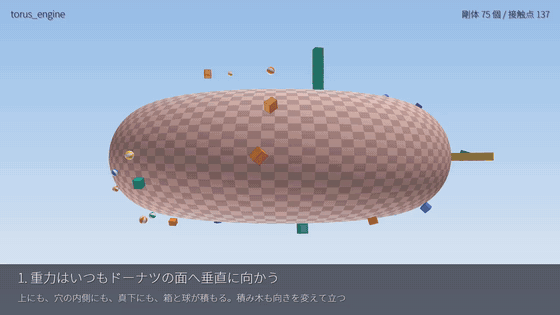

# torus_engine : ドーナツ状の空間で動く剛体物理エンジン



**動画（55 秒・音なし）: [engine/media/demo_torus.mp4](engine/media/demo_torus.mp4)**

ドーナツ（トーラス）の表面を床にして、箱と球を動かす物理エンジンです。重力はいつも面へ垂直に向かうので、ドーナツの上にも、穴の内側にも、真下にも物が積もります。端と端がつながった部屋（平らなトーラス）や、ほかの曲面、双曲空間も扱えます。

剛体（箱と球）を逐次インパルス法で解きます。C++17 だけで書いてあり、物理の部分は外部のライブラリを使いません。描画だけが [raylib](https://www.raylib.com/) を使います。土台は自作の [3D_CPP](https://github.com/RyodaiToda/3D_CPP) です。

## 動画で見せていること

動画は [engine/examples/demo_torus.cpp](engine/examples/demo_torus.cpp) が台本どおりに自動で動かして書き出したものです（手で操作していません）。

| 場面 | 見えること | 使っている機能 |
| --- | --- | --- |
| 1. 重力はいつもドーナツの面へ垂直に向かう | 約 140 個の箱と球をドーナツのまわりに落とす。上・穴の内側・真下のどこでも面に落ちて積もる。5 段の積み木の塔を 4 か所（外側の赤道、てっぺん、穴の側、真下）に立て、真下の塔は逆さまに立ったまま崩れない | `world.ground = TorusGround`、`TorusGround::place` |
| 2. 面に沿って転がる球 | 8 個の球を、すべらずに転がる回転を付けて打ち出す。線は球の通った跡で、ドーナツを巻くように進む | 摩擦と転がり、曲面の床 |
| 3. チューブを歩いて一周する | プレイヤーがてっぺんから穴をくぐり、真下を通って外側から戻る（途中で 1 回跳ぶ）。道に置いた積み木を倒していく。右下の小窓は外から見た位置 | `Walker`（向きを面に沿って運ぶ） |
| 4. 端がつながった部屋（平らなトーラス） | 右の端から出た物が左の端から入る。境目をはさんで向かい合った赤と青の球は、境目の上でぶつかってはね返る。薄い色の物はまわりの写し | `world.period` |

右上の数字は、そのときの剛体の数と接触点の数です。

## デモを動かす・動画を作り直す

このフォルダ（`engine/` の 1 つ上）で、次のようにビルドします（raylib 5.5、MinGW の g++ 15 で確かめた）。

```sh
g++ -std=c++17 -O2 -static -Iengine -I<raylib>/include \
    engine/examples/demo_torus.cpp engine/phys/world.cpp engine/phys/collision.cpp -o demo_torus.exe \
    -L<raylib>/lib -lraylib -lopengl32 -lgdi32 -lwinmm
```

```sh
demo_torus.exe                                  # ウィンドウで見る（N: 次の場面  R: 場面のやり直し）
demo_torus.exe --record demo.mp4                # 動画に書き出す（ffmpeg が PATH にあること）
demo_torus.exe --record demo.mp4 --ffmpeg C:/path/to/ffmpeg.exe --codec h264_nvenc
```

- 書き出しでは、物理を 1/120 秒ずつ 1 フレームに 2 回進め、60 fps で描きます。実時間とは関係なく進むので、何度作っても同じ動画になります。
- 2560 × 1440 で描いた画素を ffmpeg へ流しこみ、1280 × 720 に縮めます（ふちのギザギザを消すため）。
- エンコーダは `--codec` で選べます（既定は `libx264`）。上の動画は `h264_nvenc` で書き出し、3.5 Mbps に圧縮し直したものです。
- 字幕の字形は `C:/Windows/Fonts/NotoSansJP-VF.ttf` から読みます。無いときは raylib の既定の字形になり、日本語は出ません。

操作して遊べる見本は [engine/examples/walk.cpp](engine/examples/walk.cpp) です（ドーナツ、球、メビウスの帯、クラインの壺の上を歩いて、箱に球をぶつける。ビルド方法はファイルの先頭）。

## エンジンとして使う

ほかのゲームで使う手順、ファイルごとの役割、コードの書き方、しくみ、気をつけることは [engine/README.md](engine/README.md) にあります。`engine/` フォルダをまるごとコピーすれば、説明も一緒に付いていきます。

```cpp
#include "phys/grounds.h"
using namespace phys;

World world;
TorusGround torus{16.0f, 7.0f};   // 中心線の半径 16 m、チューブの半径 7 m
world.ground = torus;             // これでドーナツの面が床になり、重力が面へ向かう

RigidBody* box = world.createBox(Vec3{}, Vec3{0.5f, 0.5f, 0.5f}, 1.0f);
torus.place(box, 0.0f, -3.14159f / 2.0f, 0.5f);   // ドーナツの真下に置く（逆さまに立つ）

world.step(1.0f / 120.0f);
```

## フォルダの中身

```
torus_engine/
├── README.md            この説明（動画とデモ）
└── engine/              エンジン本体（このフォルダだけをほかのゲームへコピーして使う）
    ├── README.md        エンジンの使い方
    ├── phys/            物理（外部ライブラリなし）
    ├── draw/            raylib で描く道具
    ├── examples/        demo_torus.cpp（動画を作るデモ）、walk.cpp（操作して遊べる見本）
    └── media/           動画と GIF
```
